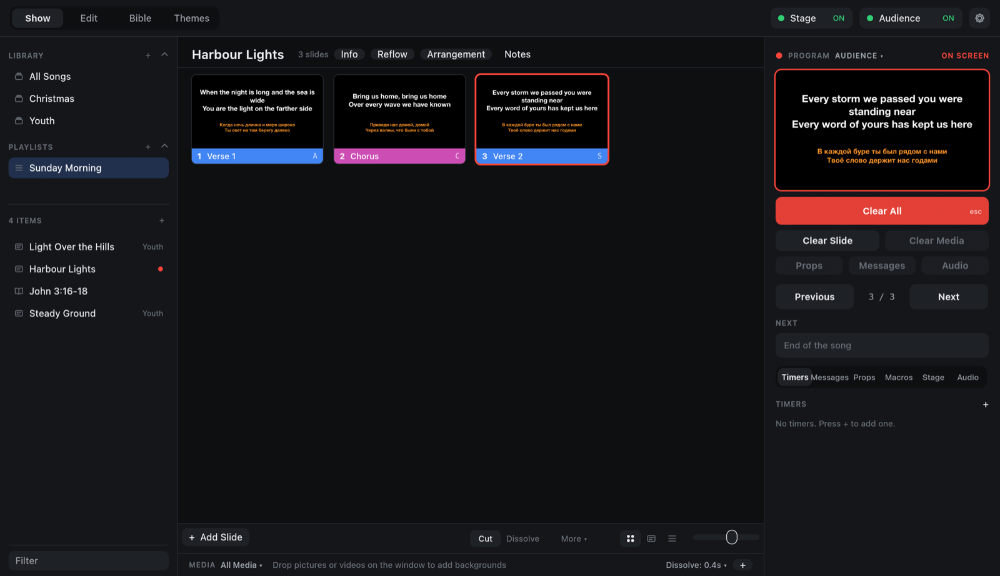
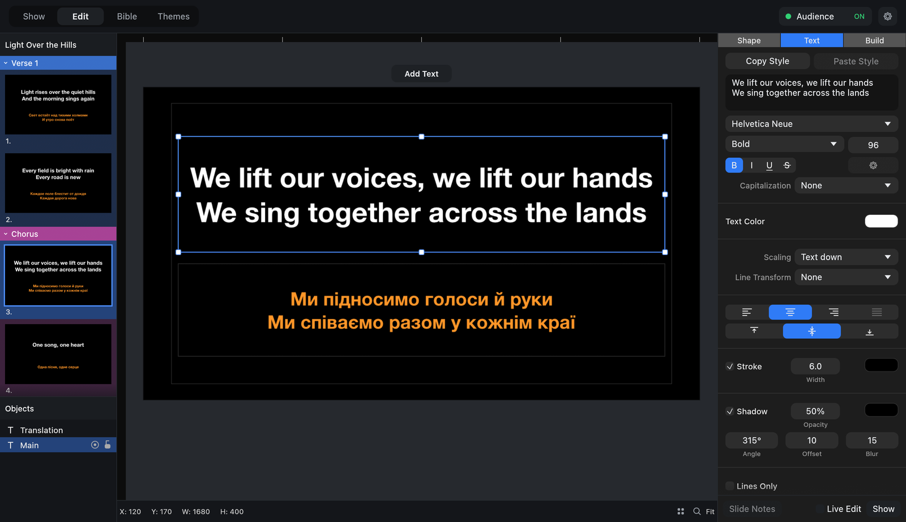
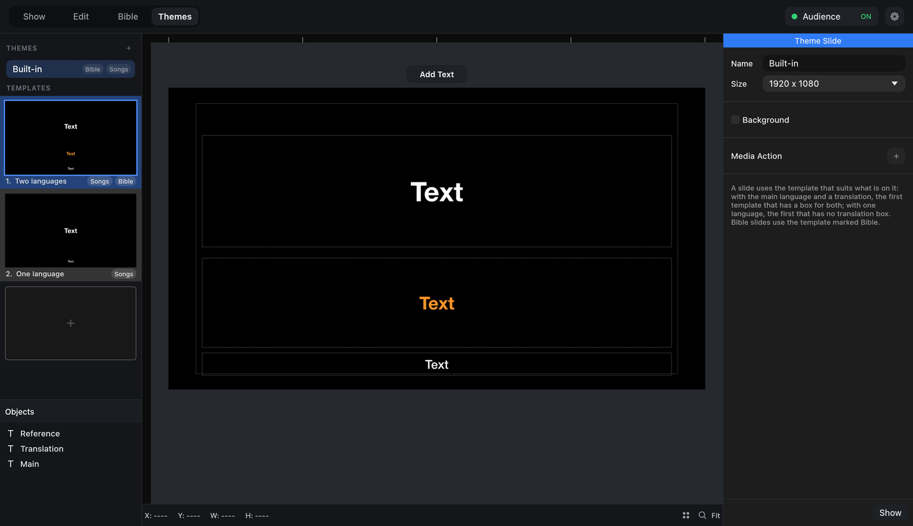
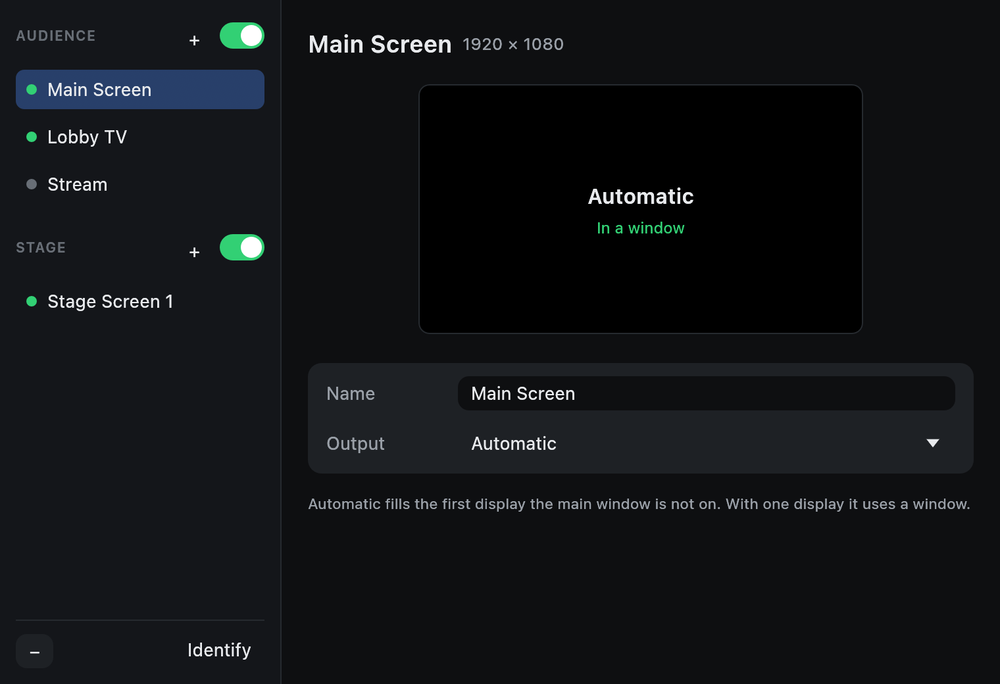

# PresenterCraft

A free, open-source app for putting song lyrics, Bible verses and pictures on the screens in a
church service. It is written in Rust, starts on macOS, and is meant to run on Windows and Linux
too.

> **Early days.** PresenterCraft is a young project. A lot of things don't work yet, some
> buttons do less than they look like they should, and file formats may still change. It is
> not ready to run a Sunday service on its own. We're building it in the open and plan to add
> much more; see [Not built yet](#not-built-yet). Bug reports and ideas are welcome in
> [Issues](https://github.com/esraell/PresenterCraft/issues).

## What this is for

Churches put words on screens every week: songs, Bible readings, notices. The apps that do it
well cost a lot, are heavy on older computers, and handle a service in two languages as an
afterthought. PresenterCraft is trying to be:

- **Free and open.** No licence fee and no account. Everything it needs, including the Bibles
  it offers to download, is hosted in this repository.
- **Made for two languages.** Every slide can carry a main language and a translation, for
  churches that sing in, say, Russian or Ukrainian and English side by side.
- **Right about the Bible.** Translations number some verses differently (the Russian Psalms
  are the best-known case). PresenterCraft lines up matching verses between translations
  instead of pairing chapter and verse numbers blindly.
- **Fast and light.** Slides are drawn on the GPU, the audience screen never waits on the
  operator's window, and it should run well on a modest laptop.
- **Familiar.** Laid out the way people who run church screens expect: libraries and playlists
  on the left, the slides in the middle, what is on screen on the right and media along the
  bottom, with a look of our own.
- **Native on the Mac,** and later on Windows and Linux.
- **Scriptable later.** The plan is for everything the operator can do to be reachable from
  an API, a command line and AI assistants (MCP).

PresenterCraft is not affiliated with or endorsed by Renewed Vision, the makers of
ProPresenter.

## What works today

**Running a service**
- Songs shown as a grid of slides, an Easy view (words only) or a Table view, with a size
  slider. Click a slide, or use the keys below, to put it on the audience screen.
- Groups (Verse 1, Chorus, Bridge…) with coloured bars and one-key jumps.
- **Arrangements**: a song's groups in the order to sing them (Verse 1, Chorus, Verse 2, Chorus…),
  from the Arrangement icon at the right of its header. Next and Previous follow it, a group can come more than
  once, the stage screens show what comes next in it, and a row of its
  groups shows the one on screen; click one to go to it, right-click to move, repeat or
  remove it, + to add a group.
- Nineteen transitions: Cut, Dissolve, Fade, Fade Black, Fade White, Push, Move In, Reveal,
  Fly In, Zoom In, Door, Flip, Swap, Wipe, Split, Blinds, Iris, Clock and Checkerboard, with
  their direction and time (0 to 5 seconds), from Cut, Dissolve or Advanced. One is chosen for all slides from the bar under the slides; a song
  (its right-click menu) and a slide can each have their own, and the media bin has its own for
  changing from one picture or video to the next.
- New Song (Command-N, or + over the song list) asks for the song's title and theme, and takes
  its words pasted in (a line in square brackets starts a group, a blank line a new slide).
- The left column: **LIBRARY** rows (All Songs and libraries of your own,
  such as Christmas or Youth) and **PLAYLISTS** rows on top, and the songs or items of the one
  chosen below, with a filter at the bottom. + beside each heading makes a new one; double-click
  or right-click a row to rename or delete it; the line under the rows can be dragged. A song
  dragged onto a library or a playlist goes into it, as does one added with the + on its row or
  from its right-click menu; a new song made while a library is shown goes into it.
- A playlist lists songs (with the library each is in) and saved Bible passages in running
  order; items can be dragged into a new order, and headers (+ over the items) group them.
  A song opened from a playlist is shown with the playlist's other songs above and below it,
  each under a bar with its name, so scrolling down goes on into the next song; clicking a slide
  of another song puts it on screen. With View, Continuous Playlist on, Next at the end of a
  song goes on to the next song in the playlist.
- Songs, slides and media items are picked out as in the Finder: Command-click adds or takes
  away one, Shift-click picks a run, and dragging across the song list, or a box across the
  slides or between media items, picks everything it touches (picking a slide never puts it on
  screen). Picked songs dragged out of the list go into a playlist or library together. Delete
  asks first, then deletes what is picked in the list last clicked; picked slides go in one
  step that Undo brings back.
- Pictures and videos dropped on the window, or added with the media bin's +, go into the media
  bin, are kept between runs, and can be shown behind the words; Delete, or Delete… on an item's
  right-click menu, takes it out of the bin after asking (the file stays where it is).
  Pictures can be PNG, JPEG, WebP, GIF, BMP, and on the Mac also HEIC (iPhone photos), TIFF,
  Photoshop, AVIF and JPEG 2000. Videos play with their sound and loop: MP4, MOV and M4V
  (including HEVC and ProRes) through macOS's own player, and everything else (MKV, WebM, AVI,
  WMV, FLV, MPEG, TS and others, or an MP4 the Mac's player can't decode, such as AV1 on an older
  Mac) through FFmpeg, played as it is, never converted first. FFmpeg must be installed for
  those for now; a release will include it; under the Program preview
  they can be paused, started again, moved through, looped or not, and muted. An item's
  right-click menu sets its Scaling (Scale to Fill, Scale to Fit, Stretch to Fill), whether a
  video loops, and the media playlists it is in; the menu beside MEDIA shows All Media or one
  playlist, and makes, renames and deletes them.
- A media playlist can **Follow a Folder**: the pictures and videos in it join the playlist as
  they appear, and one written over (such as a fresh announcements export from Canva) is read
  again and, if on screen, played again. **Play This Playlist** shows its items in turn on the
  media layer (pictures for 8 seconds, videos to their end), round and round, until other
  media is put on or cleared.
- Settings, Screens, **When PresenterCraft Opens**: play nothing, a media playlist, or a song on
  the Announcements layer, for a loop before and after the service.
- **Announcements layer**: a song's right-click menu has Play on Announcements Layer. Its
  slides go round by themselves (each for its Go to Next time, or 8 seconds) on a layer over
  the slides and media and under props and messages, dissolving from one to the next. Each
  screen's Look can show or hide it (a lobby screen can show only announcements); Clear
  Announcements (under the clear buttons while it plays, or the Clear menu) and Clear All take
  it off.
- **Media slides**: drag a media item onto a slide to have that slide show it when it goes on
  screen, or onto the space under the slides (or Add Slide) to add a slide of its own; also
  Add to Song as Slide on the item's right-click menu, and Media on a slide's. The slide's
  thumbnail shows the media behind its words.
- A slide's right-click menu: Edit, Cut, Copy, Paste, Delete, Group (mark where a verse, chorus
  or bridge starts), Copy and Paste Text Style, Label (Blank Slide, Instrumental, Repeat, Spoken Word), Transition (its own,
  or as all slides), Hot Key (a letter or digit that puts the slide on screen, shown on its
  picture), Go to Next (after a number of seconds, shown on its picture), Disable, Template.
  A song's menu has Loop to First Slide, for a loop of announcements. Undo and Redo (Command-Z, Shift-Command-Z) step back through
  these changes in the Show view, and the audience stays on the same slide.
- A song's right-click menu: Add to the playlist in front, Libraries, Rename, Duplicate, Theme (a theme of its own, or
  the songs theme), Reflow, and Delete (a song made in the app goes to the Trash).
- **Timers** (count down, count down to a time of day, or count up), **Messages** shown over
  the slides (with the time or a timer in them, an optional time to leave by themselves, a look
  of their own such as a band, a box in the middle or a lower third, and Rename, Cut, Copy,
  Paste and Duplicate),
  **Props** (things that stay over the slides until taken off, made in the editor, with an
  optional time to clear themselves), **Macros** (coloured buttons that clear layers, show or
  hide messages and props, start, stop or reset timers, switch the audience screens and go to
  songs, show a picture from the media bin, optionally when the app starts), **Audio** (playlists of tracks such as walk-in music: play, pause,
  skip 15 seconds, volume, Play Through to the next track, Shuffle, and a crossfade of up to ten
  seconds from one track into the next; F5 or Clear All stops it), and a **Stage Message** for the people on
  stage, in tabs under the Program panel. A slide can carry the same actions, done when it goes on screen.
- The Program preview shows what the audience sees, drawn by the screens' own renderer, so a
  playing video, a fade or a build moves in it as on the screens; or (from the chooser beside
  PROGRAM) what the stage screens show, with the time kept up to date.
- **Stage layouts**: each stage screen picks a layout in the Stage tab (Words and Next, Words
  Only, Words and Notes, Clock and Timer, or your own). Screens > Edit Stage Layouts… lays them
  out: the current and next slide, the next label, the clock, a timer, the slide's notes, the
  song's title and group, and the stage message, each dragged into place and resized, with its
  size, colour and alignment.

**Bible**
- Scripture Lookup in English and Russian (`John 3:16-18`, `jn 3:16`, `Psalm 23`,
  `Пс 22:1-3`) and word search.
- Up to four translations on one slide, lined up by verse using the standard versification
  tables; each row picks its Bible (or None) and the boxes its verse and reference go in.
- Options for verse numbers, a new slide for each verse, the translation's name, and where the
  reference goes; ‹ Verse and Verse › make the passage a verse longer at either end; Books picks
  a book, chapter and verse; search results open a verse or its whole chapter.
- Four Bibles ship with the app (King James, World English, Berean Standard, Russian Synodal)
  and fifteen more can be downloaded from Options › Bibles.
- One click keeps a passage: Add to "Sunday Morning" puts it in the playlist in front (the ▾
  beside it picks another), to be brought back with the same settings.

**Editing**
- An editor for a song's slides: move, resize and restyle text boxes, with alignment guides
  and a safe-area edge, multi-select (Shift or Command, or drag a box around them), copy and
  paste, undo, renaming by clicking a name, font search, and typing straight on the slide.
- Character spacing, line height, paragraph spacing, baseline and margins for a text box, under
  the gear beside B I U S.
- Text and shape fills can be a colour or a linear (at any angle) or radial gradient to a second
  colour. Every colour well opens a grid of swatches with the full colour picker under it.
- Shapes (rectangle, rounded rectangle, ellipse, triangles, rhombus, polygon, star, arrows) from
  the Shapes menu or a single key; fill, stroke, shadow and flip for any object; spreading
  objects out evenly.
- **Media** on slides (Media… above the slide, Insert > Media…, Shift-Command-I, or dropped on
  the editor from the Finder, several at once if you like): a picture,
  copied into the app's Images folder, or a video, which stays where it is and plays in its box,
  looping with its sound, while the slide is on screen (several videos on one slide all play); each can fit, fill or stretch to its
  box. The Insert
  menu also adds a text box or any shape.
- **Builds** (the inspector's Build tab): an object can come on with a Dissolve, Fly In from
  any side, or Zoom, with the slide (after its transition and a delay) or on a click of Next,
  and leave with a Dissolve, Fly Out or Zoom on a click. Next sets a slide's click builds going
  in order before it moves on; Previous takes them back. Text can be delivered By Paragraph:
  one paragraph each click, or one after another with the slide.
- A plus tile after the last slide adds a slide laid out like the one before it.
- Text can have a background colour behind its lines (under each line's words, or across the
  box), bullets or numbers before its lines, and can scroll through its box like a ticker
  (left, right, up or down), from the Text tab.
- **Linked Text**: a text box can show the clock, the date, a timer, the song's title, the
  slide's group, label or notes, the next slide's words, the stage message or the copyright line
  instead of its own words; the screens keep the time and timers up to date.
- In the Edit view: rulers numbered in the slide's pixels, showing the selected object's
  extent; Zoom (Fit, 25% to 200%, or pinch) with two-finger scrolling around a zoomed slide; and
  Grid, which shows a grid that boxes snap to.
- **Reflow** (Control-R, or Reflow beside a song's title): the song's words as text, to type
  into; the slides are rebuilt from them and keep their looks, labels and notes.
- **Cmd+N** makes a new song.

**Themes**
- A theme decides where each kind of text goes and how it looks. It has any number of
  templates, each a set of named boxes. A song's slide uses the template that suits it (two
  languages or one) unless you pick one from the slide's right-click menu; Bible slides use
  the template you choose.
- The theme editor works as the song editor does: Add Text, Shapes, Media… and pictures or
  videos dragged from the Finder. A template's shapes, pictures and videos (a logo, a bar, a
  moving background) are drawn behind the words on every slide that uses it, and a video in
  one plays while such a slide is on screen.
- Templates can be added, duplicated, renamed and deleted. Changes save as you make them.
- A theme can have a background colour and a picture behind all its slides (shown while no
  media is on), set when no box is selected in the theme editor.

**Screens**
- Any number of audience screens, each sent to a display, a window, or the network over NDI,
  all showing the same picture. Open them with the gear button or **Cmd+,**.
- Stage screens for the people on stage: the words on screen now, the next slide's words, the
  time, a running timer and the stage message.
- A screen whose display is unplugged waits for it instead of jumping to another display.
  Identify Screens marks each screen with its name, a border and a wash of its own colour that
  breathes a few times to catch the eye (the Screens window shows each screen's colour beside
  it), and the Screens menu puts a test pattern
  (colour bars, a grid, or white) on the audience screens.
- Each audience screen has a look: which layers it shows (slides, media, props, messages; a
  lobby screen might show only the media), its colour where nothing is drawn, and how much of
  each edge to cover for a screen that cuts them off.

**Copyright and settings**
- Each song's Artist, Author, Publisher, Year and CCLI Song # (the Info icon at the right of its header, beside Reflow, Arrangement and Notes), and a
  copyright line on the screens on a song's first slide, last slide or every slide, with the
  church's CCLI licence number, chosen in Settings.
- A Settings window (Cmd+,) with General, Screens, Groups and Key Mappings panes.

**From the command line**
- `presentercraft ctl …` controls the running app from a terminal, a script or an AI agent:
  what is on screen, the lists, going to slides, clearing, media, messages, props, timers,
  macros, announcements, audio, the Bible and songs, and every menu bar item. It reaches the
  app through a socket only the same user can open, and nothing listens on the network. See
  [docs/cli.md](docs/cli.md); [docs/app-map.md](docs/app-map.md) maps every part of the app.

**On the Mac**
- A menu bar with the usual menus and shortcuts (New Song, Undo, Cut/Copy/Paste, the views,
  Clear, Audience and Stage Output on/off with Cmd+1 and Cmd+2, Configure Screens), showing
  only what works.

## Not built yet

What is planned, roughly in the order it matters for a Sunday service. Sizes and details are
worked out as each is built; nothing here is promised by a date.

**Coming first**
- Importing songs: from text, rich text and Word files and the clipboard (with how slides are
  split and groups recognised), from CCLI SongSelect lyric files, and from a church's existing
  presentation software, so a library can move over in one go.
- Importing PowerPoint slides, as pictures first and editable later.
- FFmpeg included in the app, so every video format plays on a stock Mac.
- Media, countdown and placeholder items in playlists ("sermon slides to come").
- Fixing a slide's words from the Show view, in a small pop-up, without opening the editor.
- Corner pin (keystone) for off-axis projectors.
- More slide and macro actions: audio tracks and playlists, clearing audio and announcements,
  changing a stage layout or a saved screen setup, running another macro, media playlists.
- A whole song that moves on by itself every few seconds (announcement loops), set once.
- Clear buttons of your own that each clear a chosen set of layers.
- Slides shown on the stage screens only, while the audience keeps its picture.
- Saved screen setups (which layers each screen shows) switched live, and a theme for each
  screen (lower thirds on the stream, full words in the room).
- Fill-in fields in messages, typed at show time ("Parents of child {Number}…").
- What a video does when it ends, in and out points, and whether a video's sound stops the
  background music.
- A fuller stage layout editor: free text, timers by name, a video countdown, slide pictures.

**Running a service**
- A timeline that times slides, media and audio together, and can follow timecode.
- Notes kept with a whole song; a text format pop-over for many slides at once; time added to
  or taken off a running timer; timer and clock formats, and colours as time runs out.
- An audio level meter, more show shortcuts, and warnings on macros and playlists whose target
  has gone.

**Slides and editing**
- Formatting one word differently from the rest of its box; spell check.
- Slide sizes other than 1920 × 1080 (LED walls, 4:3 projectors).
- More linked text (slide number and slides left, next playlist item, time left in a video).
- Media and cut-out text as fills, web pages, custom shapes, feathering, objects shown only
  under conditions, dashed outlines, and richer builds (by letter, word or line, chained).
- Transitions with effects of their own (3D, ripples, burns), favourite transitions, and
  transitions for props.
- Groups and slide labels of your own, with colours and keys; undo that names what it undoes.

**Media and audio**
- Choosing the audio output device; what each track does at its end; in and out points and
  fades per track; sound effects over the main track; markers with a countdown on stage.
- Media kept with the library (copied in, found again when moved, unused copies cleaned up);
  a filter, a list view and a size slider for the media bin; fit-with-blur for portrait photos;
  crop, rotation and play rate per item; video effects.
- Live video inputs (cameras, capture cards, NDI sources), and video and audio streams by web
  address.
- Audio in the NDI stream; channel routing; live audio inputs.

**Bible**
- Modern licensed translations, more free Bibles in more languages, red-letter text, importing
  Bible files a church already has, and a transition of its own for Bible slides.

**Screens and stage**
- Transparent output over NDI (and key and fill) for video switchers; other screen sizes and
  NDI frame rates; colour correction and delay per screen; part of a display per screen;
  screens grouped across a video wall, with edge blending; masks other than covered edges.
- Recording or streaming a screen; Syphon output; Blackmagic SDI/HDMI outputs.
- Stage screens on phones, tablets and browsers; chord charts for the band; more stage items
  (slide count, next playlist item, group colour, playback markers).

**Library, playlists and sharing**
- Playlist templates; an arrangement chosen per playlist item; exporting a playlist with its
  songs and media; CCLI usage reporting; printing lyrics, slides and playlists.
- OpenLyrics, ChordPro, OpenSong and other formats in and out; Planning Center Services plans
  as playlists; TimelyChurch songs and schedules; a Canva announcement loop downloaded by itself.
- Folders for playlists and libraries; more song and playlist menu items.

**Remote control and integrations**
- An API over the network with a stream of changes, a phone and tablet remote, a control page
  in a browser, Stream Deck and Companion support, and MCP for AI agents (the command line
  already controls the running app; see [docs/cli.md](docs/cli.md)).
- MIDI, DMX and switcher protocols; several computers following one show; a calendar that
  starts things on schedule; VoxLive live translation shown on a screen.

**The app**
- Tested builds for Windows and Linux; editable key mappings and groups; the app in Russian and
  Ukrainian; an updates pane; a first-run guide with sample songs and media.

## Build and run

You need Rust (a recent stable release; the code uses the 2024 edition). Nothing from NDI is
needed to build or start PresenterCraft: sending a screen over NDI uses the NDI runtime that
NDI Tools installs (free, from [ndi.video](https://ndi.video)), found when an NDI screen is
turned on. Without it, NDI screens say NDI isn't installed and everything else works.

    git clone https://github.com/esraell/PresenterCraft
    cd PresenterCraft
    cargo run --release

On a Mac, to get a proper `PresenterCraft.app` (named correctly in the menu bar and the Dock):

    scripts/macos-app.sh
    open target/release/PresenterCraft.app

Song text files can be opened from the command line (`cargo run --release -- songs/*.txt`).
Other options: `--list-displays`, `--output-display N`.

## Using it

### Keys

| Key | Does |
|---|---|
| Right arrow, Space | next slide |
| Left arrow | previous slide |
| Home / End | first / last slide of the song |
| Escape (or F1) | clear the screen |
| F2 / F3 / F4 / F6 | clear the slide / the media / the props / the message |
| A, S, D, F… | jump to Verse 1, 2, 3, 4… |
| C, X, Z | jump to Chorus 1, 2, 3 |
| B, N, M | jump to Bridge 1, 2, 3 |
| P, T, I, E, O | Pre-chorus, Tag, Intro, Ending, Outro |
| Cmd+N | new song |
| Cmd+F | search the library (titles and words) |
| Cmd+, | Settings |
| Option+Cmd+1 | Screens |
| Cmd+1 / Cmd+2 | audience / stage screens on or off |
| Control+S, E, B, T | Show, Edit, Bible, Themes |

The letter for each group is shown on its first slide.

### Song text files

A song can be a plain UTF-8 text file:

    [Verse 1]
    Light rises over the quiet hills
    And the morning sings again
    --
    Свет встаёт над тихими холмами
    И утро снова поёт

    [Chorus]
    ...

- `[Name]` starts a group.
- A blank line starts a new slide.
- A line with only `--` separates the main language from its translation.

Songs made or edited in the app are saved as `.pcpres` files (JSON), which also hold where
each box sits and how it looks.

### Where things are kept

Everything lives in `~/Library/Application Support/PresenterCraft/`: songs made in the app
(`Songs/`), themes (`Themes/*.pctheme`), downloaded Bibles (`Bibles/`), services, screens and
a few preferences. Changes are written as they are made; there is no Save button.

## Licences

PresenterCraft is free software under the GNU General Public License, version 3 or (at your
option) any later version ([`LICENSE`](LICENSE)), with an additional permission for the NDI and
DeckLink libraries that people install themselves
([`ADDITIONAL-PERMISSION.md`](ADDITIONAL-PERMISSION.md)). Anyone may use it, change it and pass
it on; a version passed on stays under the same licence. [`NOTICE.md`](NOTICE.md) lists the
parts that are not PresenterCraft's own.

- **Bibles:** a Bible is offered only if its terms let anyone pass it on.
  [`docs/licences/bibles.md`](docs/licences/bibles.md) lists each one and the few conditions
  some carry (the King James text's Crown rights in the United Kingdom, for one). The verse
  tables in `crates/pc-bible/data/` come from SIL's libpalaso (MIT).
- **FFmpeg:** videos beyond MP4 and MOV are played by running FFmpeg as a separate program;
  none of its code is in or linked with PresenterCraft. See
  [`docs/licences/ffmpeg.md`](docs/licences/ffmpeg.md), including why a release must bundle an
  LGPL build and never Homebrew's.
- **NDI:** the NDI runtime is opened at run time, never linked; the few declarations needed to
  call it follow NDI's MIT-licensed headers, with their notice, in `crates/pc-ndi/src/runtime.rs`;
  [`docs/licences/ndi.md`](docs/licences/ndi.md) covers what its licence asks of a published
  build. NDI® is a registered trademark of Vizrt NDI AB.

## For developers

[docs/app-map.md](docs/app-map.md) maps the app: every view, panel and window, what each part
does, the command-line command that does the same, where the files are, and how to try the app
safely. [docs/cli.md](docs/cli.md) is the command line's reference.

    crates/pc-model    slides, groups, themes, the song text parser
    crates/pc-engine   what is live and the commands that change it (no windows)
    crates/pc-render   draws slides on the GPU: screens, thumbnails, preview
    crates/pc-bible    Bible files, references, search, verse numbering
    crates/pc-ndi      NDI output
    crates/pc-video    videos (macOS's AVFoundation, then FFmpeg) and system picture formats (ImageIO)
    crates/pc-app      the app and its windows

`unsafe` code is forbidden everywhere but two places: `pc-video`'s macOS module, which calls
macOS's media frameworks, and `pc-ndi`'s `runtime` module, which calls the NDI runtime. Each
block says why it is sound.

Before sending a change:

    cargo fmt --all --check
    cargo clippy --workspace --all-targets -- -D warnings
    cargo test --workspace

The picture tests in `pc-render` need a GPU and the macOS system font.
