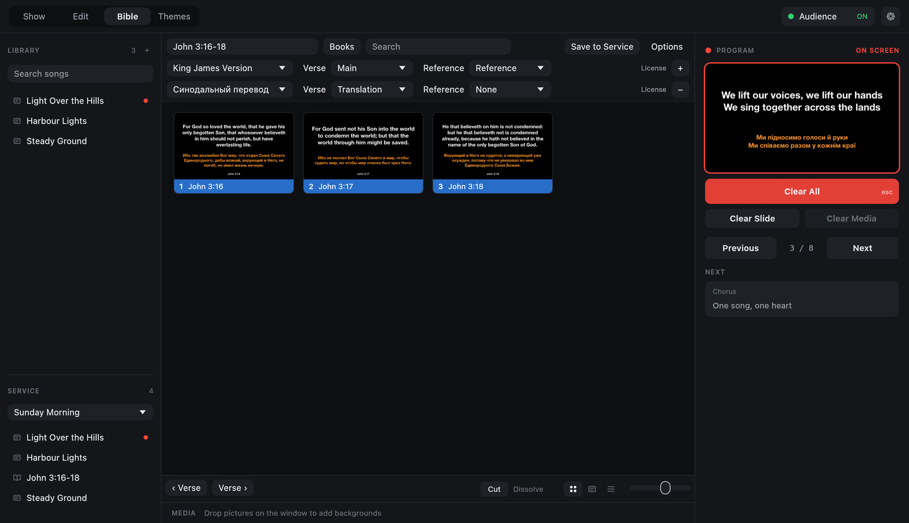

# PresenterCraft

A free, open-source app for putting song lyrics, Bible verses and pictures on the screens in a
church service. It is written in Rust, starts on macOS, and is meant to run on Windows and Linux
too.

> **Early days.** PresenterCraft is a young project. A lot of things don't work yet, some
> buttons do less than they look like they should, and file formats may still change. It is
> not ready to run a Sunday service on its own. We're building it in the open and plan to add
> much more; see [Not built yet](#not-built-yet). Bug reports and ideas are welcome in
> [Issues](https://github.com/esraell/PresenterCraft/issues).

## What this is for

Churches put words on screens every week: songs, Bible readings, notices. The apps that do it
well cost a lot, are heavy on older computers, and handle a service in two languages as an
afterthought. PresenterCraft is trying to be:

- **Free and open.** No licence fee and no account. Everything it needs, including the Bibles
  it offers to download, is hosted in this repository.
- **Made for two languages.** Every slide can carry a main language and a translation, for
  churches that sing in, say, Russian or Ukrainian and English side by side.
- **Right about the Bible.** Translations number some verses differently (the Russian Psalms
  are the best-known case). PresenterCraft lines up matching verses between translations
  instead of pairing chapter and verse numbers blindly.
- **Fast and light.** Slides are drawn on the GPU, the audience screen never waits on the
  operator's window, and it should run well on a modest laptop.
- **Familiar.** Volunteers who know ProPresenter should feel at home: the same layout, names
  and keys where they make sense, with a cleaner look of our own.
- **Native on the Mac,** and later on Windows and Linux.
- **Scriptable later.** The plan is for everything the operator can do to be reachable from
  an API, a command line and AI assistants (MCP).

PresenterCraft is not affiliated with or endorsed by Renewed Vision, the makers of
ProPresenter.

## What works today

**Running a service**
- Songs shown as a grid of slides, an Easy view (words only) or a Table view, with a size
  slider. Click a slide, or use the keys below, to put it on the audience screen.
- Groups (Verse 1, Chorus, Bridge…) with coloured bars and one-key jumps.
- Cut or Dissolve between slides, with the dissolve time. The Program preview fades with
  the screen.
- A Library of songs above a Service list (songs and saved Bible passages, in running order).
  Several services can be kept and switched between; the line between the two lists can be
  dragged.
- Pictures dropped on the window go into the media bin and can be shown behind the words.

**Bible**
- Scripture Lookup in English and Russian (`John 3:16-18`, `jn 3:16`, `Psalm 23`,
  `Пс 22:1-3`) and word search.
- Two translations on one slide, lined up by verse using the standard versification tables.
- Four Bibles ship with the app (King James, World English, Berean Standard, Russian Synodal)
  and fifteen more can be downloaded from Options › Bibles.
- Passages can be saved to the service and brought back with the same settings.

**Editing**
- An editor for a song's slides: move, resize and restyle text boxes, with alignment guides
  and a safe-area edge, multi-select (Shift or Command, or drag a box around them), copy and
  paste, undo, renaming by clicking a name, font search, and typing straight on the slide.
- Character spacing, line height and margins for a text box, under the gear beside B I U S.
- A plus tile after the last slide adds a slide laid out like the one before it.
- **Cmd+N** makes a new song.

**Themes**
- A theme decides where each kind of text goes and how it looks. It has any number of
  templates, each a set of named boxes. A song's slide uses the template that suits it (two
  languages or one) unless you pick one from the slide's right-click menu; Bible slides use
  the template you choose.
- Templates can be added, duplicated, renamed and deleted. Changes save as you make them.

**Screens**
- Any number of audience screens, each sent to a display, a window, or the network over NDI,
  all showing the same picture. Open them with the gear button or **Cmd+,**.
- Stage screens for the people on stage: the words on screen now, the next slide's words, and
  the time.
- A screen whose display is unplugged waits for it instead of jumping to another display.
  Identify Screens shows each screen's name on it.

**On the Mac**
- A menu bar with the usual menus and shortcuts (New Song, Undo, Cut/Copy/Paste, the views,
  Clear, Audience and Stage Output on/off with Cmd+1 and Cmd+2, Configure Screens), showing
  only what works.

## Not built yet

Among the things PresenterCraft can't do yet:

- Videos, audio, and live video inputs.
- Stage layouts other than the built-in one; timers, messages, props, macros.
- Transitions other than Cut and Dissolve.
- Formatting one word differently from the rest of its box.
- Importing songs from other presentation apps or from CCLI SongSelect.
- Tested builds for Windows and Linux.
- Remote control, an API, and MCP.

## Build and run

You need Rust (a recent stable release; the code uses the 2024 edition) and, for NDI, the free
NDI SDK from [ndi.video](https://ndi.video). Running a build with NDI needs the NDI runtime,
which the SDK or NDI Tools installs.

    git clone https://github.com/esraell/PresenterCraft
    cd PresenterCraft
    cargo run --release

Without the NDI SDK, everything else builds with:

    cargo run --release --no-default-features

On a Mac, to get a proper `PresenterCraft.app` (named correctly in the menu bar and the Dock):

    scripts/macos-app.sh
    open target/release/PresenterCraft.app

Song text files can be opened from the command line (`cargo run --release -- songs/*.txt`).
Other options: `--list-displays`, `--output-display N`.

## Using it

### Keys

| Key | Does |
|---|---|
| Right arrow, Space | next slide |
| Left arrow | previous slide |
| Home / End | first / last slide of the song |
| Escape (or F1) | clear the screen |
| A, S, D, F… | jump to Verse 1, 2, 3, 4… |
| C, X, Z | jump to Chorus 1, 2, 3 |
| B, N, M | jump to Bridge 1, 2, 3 |
| P, T, I, E, O | Pre-chorus, Tag, Intro, Ending, Outro |
| Cmd+N | new song |
| Cmd+, or Option+Cmd+1 | Screens |
| Cmd+1 / Cmd+2 | audience / stage screens on or off |
| Control+S, E, B, T | Show, Edit, Bible, Themes |

The letter for each group is shown on its first slide.

### Song text files

A song can be a plain UTF-8 text file:

    [Verse 1]
    Light rises over the quiet hills
    And the morning sings again
    --
    Свет встаёт над тихими холмами
    И утро снова поёт

    [Chorus]
    ...

- `[Name]` starts a group.
- A blank line starts a new slide.
- A line with only `--` separates the main language from its translation.

Songs made or edited in the app are saved as `.pcpres` files (JSON), which also hold where
each box sits and how it looks.

### Where things are kept

Everything lives in `~/Library/Application Support/PresenterCraft/`: songs made in the app
(`Songs/`), themes (`Themes/*.pctheme`), downloaded Bibles (`Bibles/`), services, screens and
a few preferences. Changes are written as they are made; there is no Save button.

## Licences

PresenterCraft's own licence is still being chosen and will be added to this repository.

- **Bibles:** a Bible is offered only if its terms let anyone pass it on.
  [`docs/licences/bibles.md`](docs/licences/bibles.md) lists each one and the few conditions
  some carry (the King James text's Crown rights in the United Kingdom, for one). The verse
  tables in `crates/pc-bible/data/` come from SIL's libpalaso (MIT).
- **NDI:** nothing from the NDI SDK is in this repository;
  [`docs/licences/ndi.md`](docs/licences/ndi.md) covers what its licence asks of a published
  build. NDI® is a registered trademark of Vizrt NDI AB.

## For developers

    crates/pc-model    slides, groups, themes, the song text parser
    crates/pc-engine   what is live and the commands that change it (no windows)
    crates/pc-render   draws slides on the GPU: screens, thumbnails, preview
    crates/pc-bible    Bible files, references, search, verse numbering
    crates/pc-ndi      NDI output
    crates/pc-app      the app and its windows

Before sending a change:

    cargo fmt --all --check
    cargo clippy --workspace --all-targets -- -D warnings
    cargo test --workspace

The picture tests in `pc-render` need a GPU and the macOS system font.
