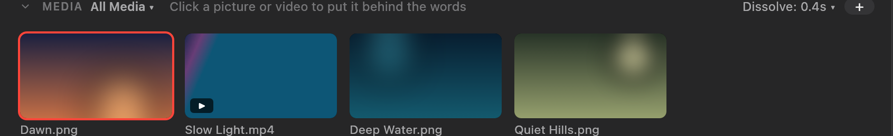
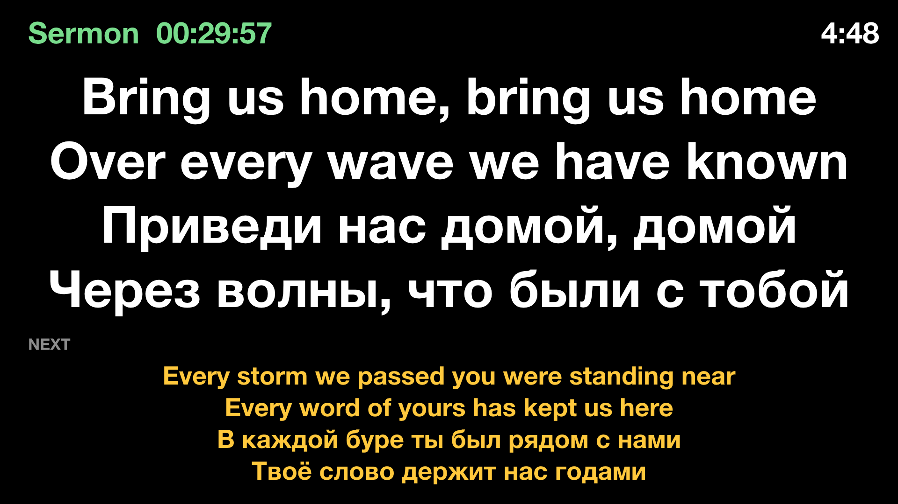
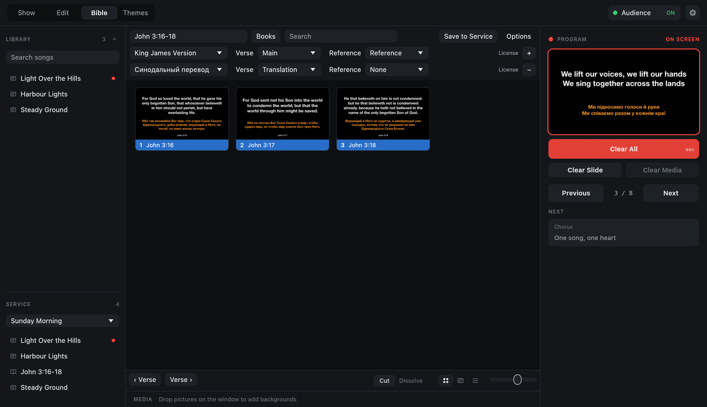
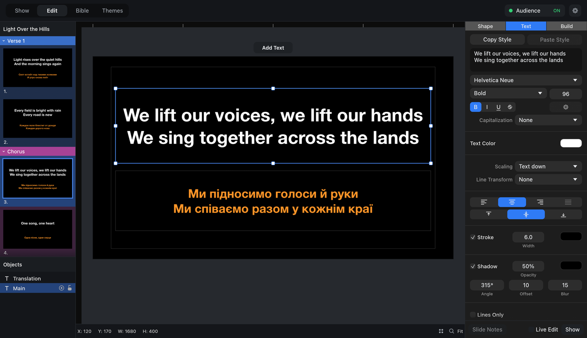
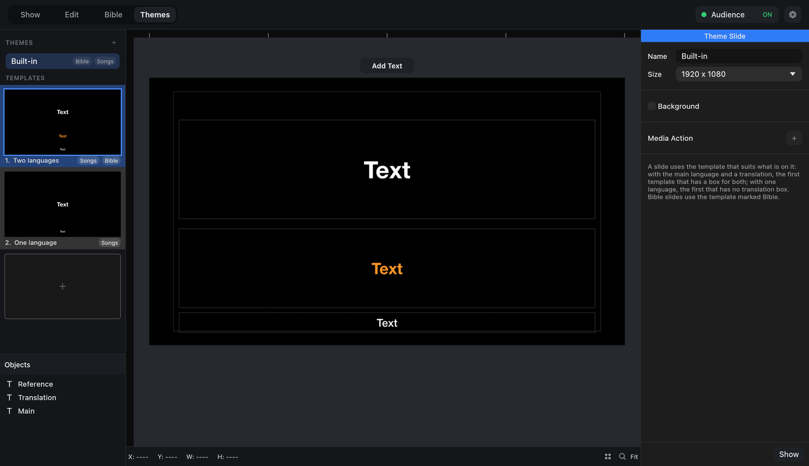
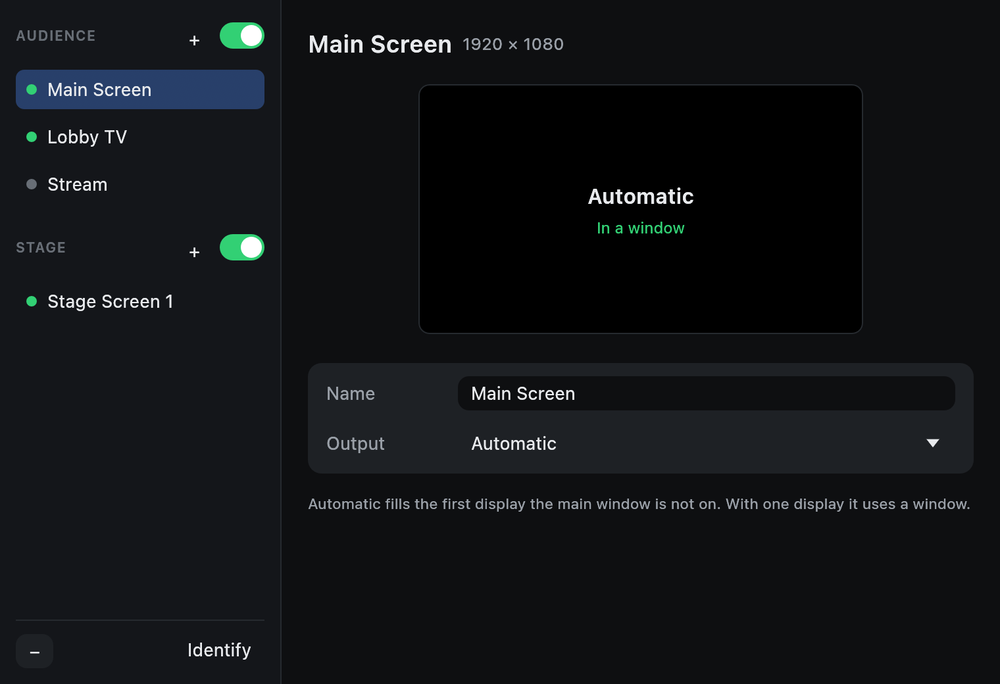

# What SoftPresenter does today

Everything that works now, area by area. The [README](../README.md) gives the overview;
[roadmap.md](roadmap.md) lists what is planned; [app-map.md](app-map.md) shows where each part
of the app is and which command-line command does the same; [cli.md](cli.md) covers the command
line.

SoftPresenter is young: some of this is rough, and file formats may still change. When a
feature changes, this page changes in the same commit.

## Running a service
- Songs shown as a grid of slides, an Easy view (words only) or a Table view, with a size
  slider. Click a slide, or use the [keys](../README.md#keys), to put it on the audience screen.
- Groups (Verse 1, Chorus, Bridge…) with coloured bars and one-key jumps.
- **Arrangements**: a song's groups in the order to sing them (Verse 1, Chorus, Verse 2, Chorus…),
  from the Arrangement icon at the right of its header. Next and Previous follow it, a group can come more than
  once, the stage screens show what comes next in it, and a row of its
  groups shows the one on screen; click one to go to it, right-click to move, repeat or
  remove it, + to add a group.
- Nineteen transitions: Cut, Dissolve, Fade, Fade Black, Fade White, Push, Move In, Reveal,
  Fly In, Zoom In, Door, Flip, Swap, Wipe, Split, Blinds, Iris, Clock and Checkerboard, with
  their direction and time (0 to 5 seconds), from Cut, Dissolve or Advanced. One is chosen for all slides from the bar under the slides; a song
  (its right-click menu) and a slide can each have their own, and the media bin has its own for
  changing from one picture or video to the next.
- New Song (Command-N, or + over the song list) asks for the song's title and theme, and takes
  its words pasted in (a line in square brackets starts a group, a blank line a new slide; a
  lyric file pasted in whole gives its sections and details, as an import does).
- **Importing songs.** File › Import Songs…, dropping files on the window, `sp song import
  FILE…`, or song files named on the command line. It reads plain text in any common encoding
  (UTF-8, UTF-16, and the older Windows ones for Russian, Ukrainian and Western European
  languages), the lyric files song services give (title, sections, and a footer whose song
  number, writers and copyright go into the song's details; a church's own licence number is
  never kept), ChordPro (sections from its directives, chords taken out), SoftPresenter's own
  song text and song files, rich text, and on macOS Word and OpenDocument files.
- **Slides from PowerPoint, Keynote, a PDF or pictures.** File › Import Slides…, dropping the
  file or a folder of pictures on the window, or `sp song import`. A PowerPoint, Keynote or
  OpenDocument presentation is turned into a PDF by a program on the Mac that opens it
  (Keynote, then PowerPoint, then LibreOffice for PowerPoint files; Keynote for Keynote files),
  so its slides look exactly as that program draws them; macOS asks once to allow it, and a
  program SoftPresenter opened is closed again. Each page or picture becomes
  a slide showing it across the whole slide, in a new presentation named after the file or
  folder. Pages are drawn at up to 1920 × 1080 on white, turned and cropped as the PDF says, and
  saved in the Images folder, so the deck keeps working when the file moves. Pictures in a
  folder go in the order people number them (Slide2 before Slide10). It happens in the
  background, so the window and keys go on working; a 60-page deck takes about ten seconds.
  With no program that opens the file, it says what to install, or to export a PDF.
- **Bringing songs across from SoftProjector.** Its database (`spData.sqlite`) or an exported
  songbook (`.sps`), dropped on the window or chosen in File › Import Songs…: each songbook
  becomes a library of its name, each song keeps its number before its title (so "123" still
  finds it), its lyricist and composer, its verses, choruses and other parts as groups (a
  "&Куплет" part as more slides of its verse), and an arrangement, "As sung", that repeats the
  chorus after every verse as SoftProjector does. Read with macOS's own SQLite tool, read-only.
- **Bringing a library across from ProPresenter 7.** File › Import from ProPresenter… opens
  its Libraries folder; choose song documents, one library, or the folder of all of them. Each folder becomes a
  library of the same name. Each song keeps its groups, slides, arrangements (and the one
  chosen), slide labels and notes, slides switched off, and its copyright details. A slide's
  text box in the largest type becomes the words, the next the translation, and a line such as
  "Psalm 133:3" the reference. `.pro` files can also be dropped on the window or given to
  `sp song import`. Documents with pictures or videos but no words are listed as not imported
  for now. A library of 4,372 songs comes across in about a third of a second.
  Sections are found from lines naming them ("Verse 1", "Chorus:", "Bridge", "Куплет 1",
  "Припев", "Приспів"…); slides break at blank lines, and more than four lines without one are
  shared out evenly (eight lines make two slides of four). A song the library already has,
  word for word under the same title, isn't added twice.
- The left column: **LIBRARY** rows (All Songs and libraries of your own,
  such as Christmas or Youth) and **PLAYLISTS** rows on top, and the songs or items of the one
  chosen below, with a filter at the bottom. + beside each heading makes a new one; double-click
  or right-click a row to rename or delete it; the line under the rows can be dragged. A song
  dragged onto a library or a playlist goes into it, as does one added with the + on its row or
  from its right-click menu; a new song made while a library is shown goes into it.
- A playlist lists songs (with the library each is in) and saved Bible passages in running
  order; items can be dragged into a new order, and headers (+ over the items) group them.
  A song opened from a playlist is shown with the playlist's other songs above and below it,
  each under a bar with its name, so scrolling down goes on into the next song; clicking a slide
  of another song puts it on screen. With View, Continuous Playlist on, Next at the end of a
  song goes on to the next song in the playlist.
- Songs, slides and media items are picked out as in the Finder: Command-click adds or takes
  away one, Shift-click picks a run, and dragging across the song list, or a box across the
  slides or between media items, picks everything it touches (picking a slide never puts it on
  screen). Picked songs dragged out of the list go into a playlist or library together. Delete
  asks first, then deletes what is picked in the list last clicked; picked slides go in one
  step that Undo brings back.
- Pictures and videos dropped on the window, or added with the media bin's +, go into the media
  bin, are kept between runs, and can be shown behind the words; Delete, or Delete… on an item's
  right-click menu, takes it out of the bin after asking (the file stays where it is).
  Pictures can be PNG, JPEG, WebP, GIF, BMP, and on the Mac also HEIC (iPhone photos), TIFF,
  Photoshop, AVIF and JPEG 2000. Videos play with their sound and loop: MP4, MOV and M4V
  (including HEVC and ProRes) through macOS's own player, and everything else (MKV, WebM, AVI,
  WMV, FLV, MPEG, TS and others, or an MP4 the Mac's player can't decode, such as AV1 on an older
  Mac) through FFmpeg, played as it is, never converted first. FFmpeg must be installed for
  those for now; a release will include it; under the Program preview
  they can be paused, started again, moved through, looped or not, and muted. An item's
  right-click menu sets its Scaling (Scale to Fill, Scale to Fit, Stretch to Fill), whether a
  video loops, and the media playlists it is in; the menu beside MEDIA shows All Media or one
  playlist, and makes, renames and deletes them.

- A media playlist can **Follow a Folder**: the pictures and videos in it join the playlist as
  they appear, and one written over (such as a fresh announcements export from Canva) is read
  again and, if on screen, played again. **Play This Playlist** shows its items in turn on the
  media layer (pictures for 8 seconds, videos to their end), round and round, until other
  media is put on or cleared.
- Settings, Screens, **When SoftPresenter Opens**: play nothing, a media playlist, or a song on
  the Announcements layer, for a loop before and after the service.
- **Announcements layer**: a song's right-click menu has Play on Announcements Layer. Its
  slides go round by themselves (each for its Go to Next time, or 8 seconds) on a layer over
  the slides and media and under props and messages, dissolving from one to the next. Each
  screen's Look can show or hide it (a lobby screen can show only announcements); Clear
  Announcements (under the clear buttons while it plays, or the Clear menu) and Clear All take
  it off.
- **Media slides**: drag a media item onto a slide to have that slide show it when it goes on
  screen, or onto the space under the slides (or Add Slide) to add a slide of its own; also
  Add to Song as Slide on the item's right-click menu, and Media on a slide's. The slide's
  thumbnail shows the media behind its words.
- A slide's right-click menu: Edit, Cut, Copy, Paste, Delete, Group (mark where a verse, chorus
  or bridge starts), Copy and Paste Text Style, Label (Blank Slide, Instrumental, Repeat, Spoken Word), Transition (its own,
  or as all slides), Hot Key (a letter or digit that puts the slide on screen, shown on its
  picture), Go to Next (after a number of seconds, shown on its picture), Disable, Template.
  A song's menu has Loop to First Slide, for a loop of announcements. Undo and Redo (Command-Z, Shift-Command-Z) step back through
  these changes in the Show view, and the audience stays on the same slide.
- A song's right-click menu: Add to the playlist in front, Libraries, Rename, Duplicate, Theme (a theme of its own, or
  the songs theme), Reflow, and Delete (a song made in the app goes to the Trash).
- **Timers** (count down, count down to a time of day, or count up), **Messages** shown over
  the slides (with the time or a timer in them, an optional time to leave by themselves, a look
  of their own such as a band, a box in the middle or a lower third, and Rename, Cut, Copy,
  Paste and Duplicate),
  **Props** (things that stay over the slides until taken off, made in the editor, with an
  optional time to clear themselves), **Macros** (coloured buttons that clear layers, show or
  hide messages and props, start, stop or reset timers, switch the audience screens and go to
  songs, show a picture from the media bin, optionally when the app starts), **Audio** (playlists of tracks such as walk-in music: play, pause,
  skip 15 seconds, volume, Play Through to the next track, Shuffle, and a crossfade of up to ten
  seconds from one track into the next; F5 or Clear All stops it), and a **Stage Message** for the people on
  stage, in tabs under the Program panel. A slide can carry the same actions, done when it goes on screen.
- The Program preview shows what the audience sees, drawn by the screens' own renderer, so a
  playing video, a fade or a build moves in it as on the screens; or (from the chooser beside
  PROGRAM) what the stage screens show, with the time kept up to date.
- **Stage layouts**: each stage screen picks a layout in the Stage tab (Words and Next, Words
  Only, Words and Notes, Clock and Timer, or your own). Screens > Edit Stage Layouts… lays them
  out: the current and next slide, the next label, the clock, a timer, the slide's notes, the
  song's title and group, and the stage message, each dragged into place and resized, with its
  size, colour and alignment.

## Bible
- Scripture Lookup in English, Russian and Ukrainian (`John 3:16-18`, `jn 3:16`, `Psalm 23`,
  `Пс 22:1-3`, `Ів 3:16`) and word search. A short form is read in the language of the first
  translation first ("1 Цар" is 1 Samuel to a Russian Bible, 1 Kings to a Ukrainian one), and a
  Ukrainian Bible shows its books' Ukrainian names.
- The slides follow what is typed in Scripture Lookup a moment after typing stops, without
  waiting for Return (nothing goes on screen until a slide is clicked). While a book's name is
  being typed, the books it could be are offered under the field (arrows pick, Tab or Return
  takes one). Control-B, from anywhere, goes to the Bible page with the field's words selected,
  ready for the next reference.
- History lists the passages that were on screen, newest first, with the time (or the day,
  for earlier ones); one click brings a passage back. It is kept between starts, holds the last
  hundred, and Clear History empties it.
- Up to four translations on one slide, lined up by verse using the standard versification
  tables; each row picks its Bible (or None) and the boxes its verse and reference go in.
- Options opens a panel: what each slide shows (one verse, or the whole passage), verse numbers,
  the translation's name, where the reference goes (on every slide, the whole passage on every
  slide or the last, or none) and the theme, beside a preview of the first and last slides that
  changes as they are clicked (the passage showing, or two sample verses). Manage Bibles… opens
  the Bibles window. ‹ Verse and Verse › make the passage a verse longer at either end; search
  results open a verse or its whole chapter.
- Book, chapter and verse lists beside the slides (Hide, at their top, puts them away and Books
  brings them back; the choice is kept): a click on a
  verse looks it up at once, Shift-click makes a passage from the verse before, All takes the
  whole chapter. The passage showing is lit in them, however it was looked up.
- Four Bibles ship with the app (King James, World English, Berean Standard, Russian Synodal)
  and sixteen more can be downloaded. Options › Bibles opens the Bibles window: a search box,
  the Bibles installed (each with Remove, but for the four built in), and every Bible that can
  be downloaded, grouped by language and written in it, with its terms and an Install button
  that shows the download going on.
- One click keeps a passage: Add to "Sunday Morning" puts it in the playlist in front (the ▾
  beside it picks another), to be brought back with the same settings.

## Editing
- An editor for a song's slides: move, resize and restyle text boxes, with alignment guides
  and a safe-area edge, multi-select (Shift or Command, or drag a box around them), copy and
  paste, undo, renaming by clicking a name, font search, and typing straight on the slide.
- Character spacing, line height, paragraph spacing, baseline and margins for a text box, under
  the gear beside B I U S.
- Text and shape fills can be a colour or a linear (at any angle) or radial gradient to a second
  colour. Every colour well opens a grid of swatches with the full colour picker under it.
- Shapes (rectangle, rounded rectangle, ellipse, triangles, rhombus, polygon, star, arrows) from
  the Shapes menu or a single key; fill, stroke, shadow and flip for any object; spreading
  objects out evenly.
- **Media** on slides (Media… above the slide, Insert > Media…, Shift-Command-I, or dropped on
  the editor from the Finder, several at once if you like): a picture,
  copied into the app's Images folder, or a video, which stays where it is and plays in its box,
  looping with its sound, while the slide is on screen (several videos on one slide all play); each can fit, fill or stretch to its
  box. The Insert
  menu also adds a text box or any shape.
- **Builds** (the inspector's Build tab): an object can come on with a Dissolve, Fly In from
  any side, or Zoom, with the slide (after its transition and a delay) or on a click of Next,
  and leave with a Dissolve, Fly Out or Zoom on a click. Next sets a slide's click builds going
  in order before it moves on; Previous takes them back. Text can be delivered By Paragraph:
  one paragraph each click, or one after another with the slide.
- A plus tile after the last slide adds a slide laid out like the one before it.
- Text can have a background colour behind its lines (under each line's words, or across the
  box), bullets or numbers before its lines, and can scroll through its box like a ticker
  (left, right, up or down), from the Text tab.
- **Linked Text**: a text box can show the clock, the date, a timer, the song's title, the
  slide's group, label or notes, the next slide's words, the stage message or the copyright line
  instead of its own words; the screens keep the time and timers up to date.
- In the Edit view: rulers numbered in the slide's pixels, showing the selected object's
  extent; Zoom (Fit, 25% to 200%, or pinch) with two-finger scrolling around a zoomed slide; and
  Grid, which shows a grid that boxes snap to.
- **Reflow** (Control-R, or Reflow beside a song's title): the song's words as text, to type
  into; the slides are rebuilt from them and keep their looks, labels and notes.
- **Cmd+N** makes a new song.

## Themes
- A theme decides where each kind of text goes and how it looks. It has any number of
  templates, each a set of named boxes. A song's slide uses the template that suits it (two
  languages or one) unless you pick one from the slide's right-click menu; Bible slides use
  the template you choose.
- Two themes come with the app: Built-in, for songs, and Bible, which Bible slides start with:
  the Russian Synodal verse and its reference on top, the King James Version and its reference
  below, in Linux Biolinum on black. Either can be changed and saved, and neither can be
  deleted. (Bible's settings live in `crates/sp-model/themes/bible.sptheme`.)
- The theme editor works as the song editor does: Add Text, Shapes, Media… and pictures or
  videos dragged from the Finder. A template's shapes, pictures and videos (a logo, a bar, a
  moving background) are drawn behind the words on every slide that uses it, and a video in
  one plays while such a slide is on screen.
- Templates can be added, duplicated, renamed and deleted. Changes save as you make them.
- A theme can have a background colour and a picture behind all its slides (shown while no
  media is on), set when no box is selected in the theme editor.

## Getting started
- The first start on a Mac (and the first start after updating, on a Mac set up before there
  was a setup) opens a short setup: which display the congregation sees (by name, never the
  main display; the screen goes there at once, and Identify shows each screen's name) and an
  optional stage display, or a window or NDI on a Mac with one display; bringing songs in (one
  click for a ProPresenter library found on the Mac, or song files); which Bible goes on top
  and which below; and what macOS will ask permission for and why. SoftPresenter › Set Up
  SoftPresenter… opens it again.

## Screens
- Any number of audience screens, each sent to a display, a window, or the network over NDI,
  all showing the same picture, set up in the Screens window (**Option-Command-1**).
- Stage screens for the people on stage: the words on screen now, the next slide's words, the
  time, a running timer and the stage message.
- Screens fill displays by the names System Settings shows ("3DTV", "HP 27f"). The main
  display, with the menu bar, is never offered and never filled: it is where SoftPresenter's
  own window is. A fresh start puts the first screen on the first other display, or in a
  window on a Mac with one display.
- Switching the audience (or stage) screens off closes their windows, so the display shows
  what is behind them, not black; NDI goes on sending black, so a stream keeps its source. A
  screen in a window opens on a display the operator doesn't work on when there is one.
- A screen keeps the display it was set to, by name. If that display isn't connected, the
  Screens window shows it as disconnected and the screen shows nothing anywhere (it never
  jumps to another display); it goes back to its display as soon as it is connected again.
  Identify Screens marks each screen with its name, a border and a wash of its own colour that
  breathes a few times to catch the eye (the Screens window shows each screen's colour beside
  it), and the Screens menu puts a test pattern
  (colour bars, a grid, or white) on the audience screens.
- Each audience screen has a look: which layers it shows (slides, media, props, messages; a
  lobby screen might show only the media), its colour where nothing is drawn, and how much of
  each edge to cover for a screen that cuts them off.

## Copyright and settings
- Each song's Artist, Author, Publisher, Year and CCLI Song # (the Info icon at the right of its header, beside Reflow, Arrangement and Notes), and a
  copyright line on the screens on a song's first slide, last slide or every slide, with the
  church's CCLI licence number, chosen in Settings.
- A Settings window (Cmd+,) with General, Screens, Groups and Key Mappings panes.

## From the command line
- `sp …` (full name `softpresenter`), installed from SoftPresenter › Install Command Line Tool…,
  controls the running app from a terminal, a script or an AI agent (`sp status`, `sp next`):
  what is on screen, the lists, going to slides, clearing, media, messages, props, timers,
  macros, announcements, audio, the Bible and songs, and every menu bar item. It reaches the
  app through a socket only the same user can open, and nothing listens on the network. See
  [cli.md](cli.md); [app-map.md](app-map.md) maps every part of the app.

## On the Mac
- A menu bar with the usual menus and shortcuts (New Song, Import Songs…, Undo, Cut/Copy/Paste, the views,
  Clear, Audience and Stage Output on/off with Cmd+1 and Cmd+2, Configure Screens), showing
  only what works.
